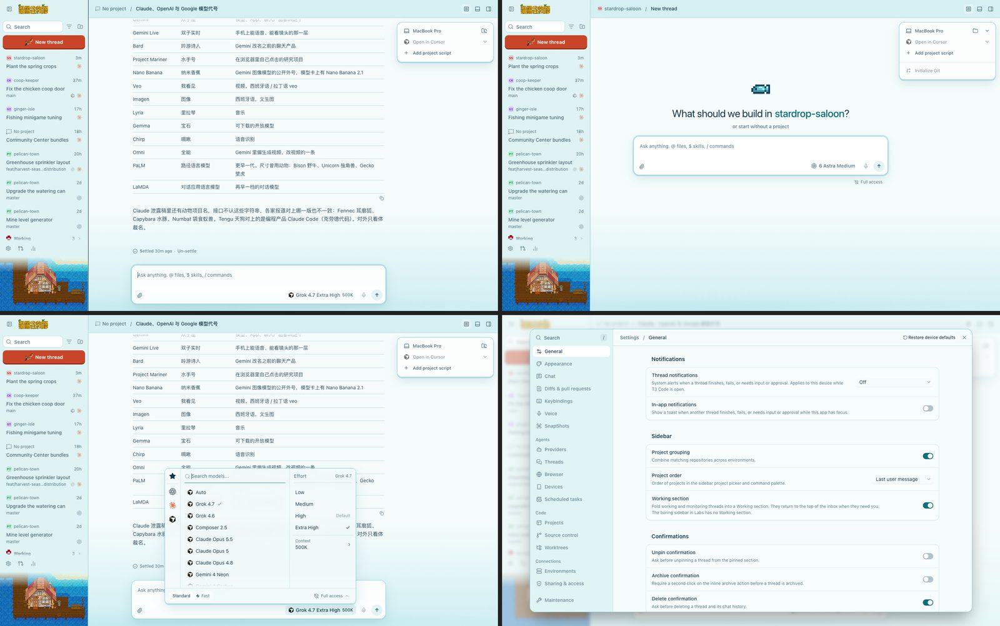
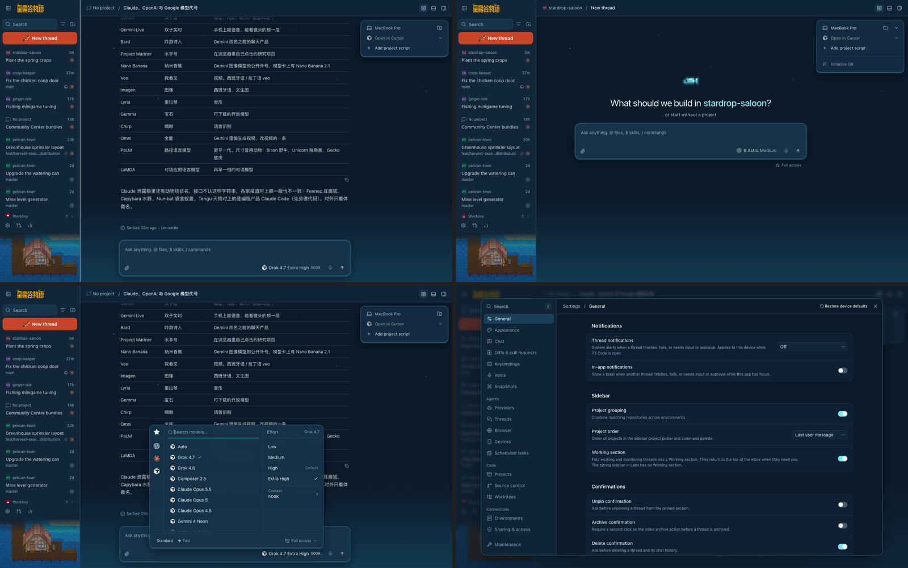
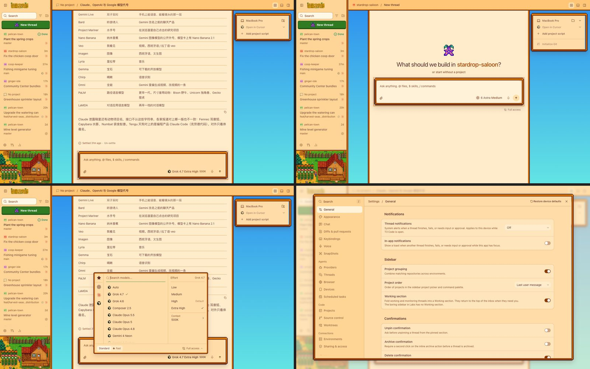
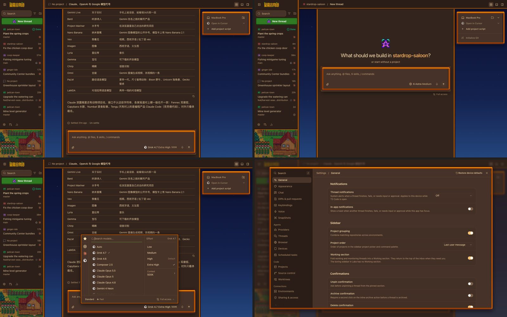
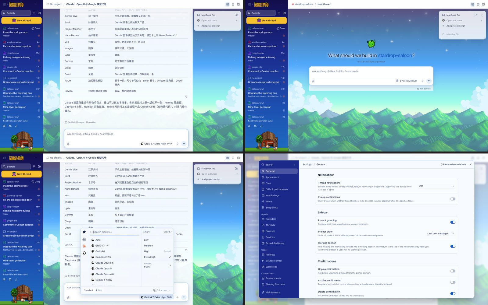
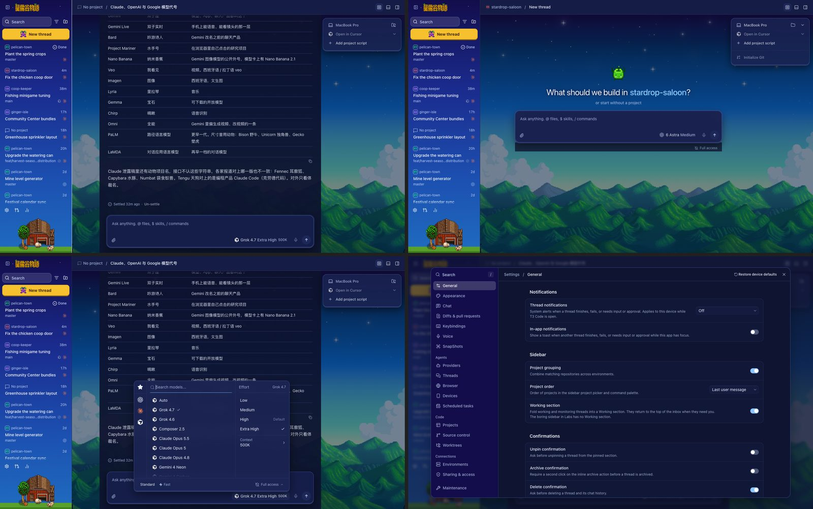

# 星露谷主题 for T3 Code

三个星露谷物语风格的 [T3 Code](https://t3.codes) 主题，放在同一个仓库里，各自独立，装哪个都行。每个都带浅色和深色两套。

| 主题 | id | 浅色 | 深色 |
| --- | --- | --- | --- |
| 海岛码头 | `stardew-island` |  |  |
| 游戏菜单 | `stardew-menu` |  |  |
| 封面 | `stardew-cover` |  |  |

## 在 T3 Code 里使用

主题只对网页版和桌面版生效，手机端不使用主题。

### 1. 安装

一个主题由两个同名文件组成：`<id>.json`（配色和样式）和 `<id>.jpg` / `<id>.png`（背景图）。把它们放进 T3 Code 的主题目录即可：

    git clone git@github.com:TomatoDroid/t3code-stardew-themes.git
    cd t3code-stardew-themes
    mkdir -p ~/.t3/userdata/themes
    cp themes/* ~/.t3/userdata/themes/

只想装一个就只复制那一对文件，例如：

    cp themes/stardew-island.json themes/stardew-island.jpg ~/.t3/userdata/themes/

两个文件要一起复制，缺了图片主题仍能用，但没有背景。

### 2. 切换

打开 T3 Code 的 Settings → Appearance，在主题列表里选「星露谷 · 海岛码头」「星露谷 · 游戏菜单」或「星露谷 · 封面」。浅色 / 深色跟随 T3 Code 自己的外观设置。

也可以直接在对话里跟 agent 说「把主题换成 stardew-menu」。

### 3. 更新和卸载

- 更新：`git pull` 后重新复制一次，覆盖旧文件。
- 卸载：先在设置里切回内置主题（t3-chat、grove、ocean、ember、iris），再删除 `~/.t3/userdata/themes/` 里对应的两个文件。

### 小提示

- 窗口高度不足 640px 时，侧栏底部的插画会自动隐藏，把空间让给对话列表。
- 系统开了「减少动态效果」时，图标的浮动动画会关闭。

## 自己改主题

`themes/` 里的文件是构建产物，不要手改，改源码后重新生成：

    pip install pillow
    python build.py            # 生成 themes/<id>.json 和背景图
    python build.py --install  # 生成后直接复制到 ~/.t3/userdata/themes

- `build.py`：三套调色板和 CSS。构建时会检查文字对比度，低于 4.5 直接失败；CSS 超过 50,000 字符也会失败。
- `assets.py`：小图标（内嵌进 CSS）和三张背景图。
- `farm.py`：「游戏菜单」主题的农场拼图。
- `wiki-assets/`、`wiki-assets-farm/`、`art/`：原始素材。

### 截图自检

    "/Applications/Google Chrome.app/Contents/MacOS/Google Chrome" --headless=new \
      --remote-debugging-port=9333 --user-data-dir=<某个空目录> --window-size=1440,900 http://127.0.0.1:3773/
    THREAD_URL=<一个对话的地址> python shots.py <themeId> <light|dark> <tag> [shots/extra.json]
    python montage.py shots/sheet.png shots/a.png shots/b.png ...

`PAGE_JS=<文件>` 可以在截图前往页面里跑一段脚本，比如把侧栏里的私人对话标题替换掉再截公开用的图。

无头浏览器第一次要配对：`t3 pair --scope orchestration:read --ttl 5m`，用完用 `t3 auth session revoke <id>` 撤销。`shots.py` 是把主题直接注入页面，不需要先安装；`SIZE=1100x600` 可以改窗口大小。

## 已知限制

- 主题格式每个主题只允许一张图片文件，所以小图标（logo、鱼漂、祝尼魔等）内嵌在 CSS 里，「封面」占 CSS 上限的 54%。
- 选择器只用 `data-*` / `aria-*` 属性，不用编译出来的类名；但 T3 Code 改了页面结构后仍可能需要调整。
- 终端文字、文件树、diff 内部无法用 CSS 改，只跟随颜色角色。

## 素材版权

这是非官方的粉丝作品，与 ConcernedApe 及 T3 Code 官方无关。游戏美术素材版权归 ConcernedApe 所有，来自 Stardew Valley Wiki 和官网背景图，不得商用。
